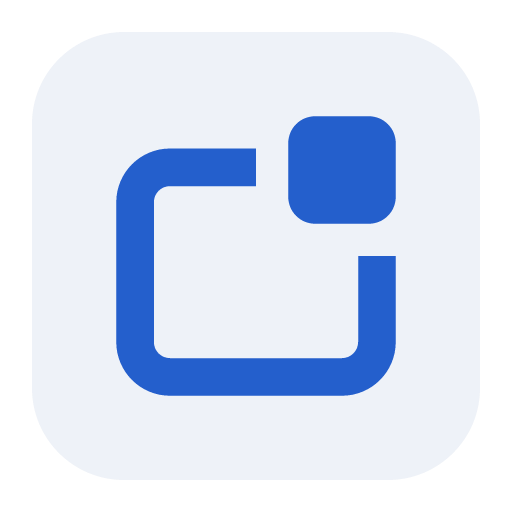
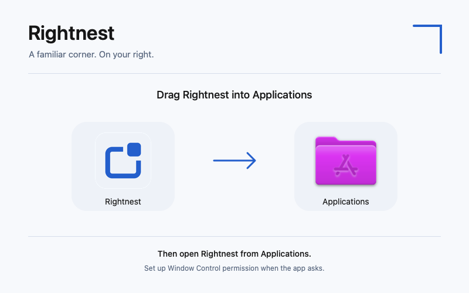

  

# Rightnest

**A familiar corner. Window controls on your right.**

Rightnest adds minimize, fit/restore and close buttons to the right of supported macOS windows. Built for people who feel more at home with Windows-style placement. Your original macOS controls stay available.

### [Download Rightnest for Mac →](https://github.com/Bartu-Ercan/Rightnest/releases/latest)

**Apple Silicon · Early access · Free and open source**

The link opens the latest release, with the DMG and checksum under **Assets**. Intel Macs are not supported. The API minimum is macOS 13; device testing so far is on macOS 27.0 (26A428). Earlier macOS versions have not been device-validated.

> Rightnest is locally signed, **not Apple Developer ID signed or notarized**. macOS may block a downloaded copy. Read the [installation guide](docs/INSTALL.md) before installing; managed Macs may prohibit it. Do not disable system protections.

## Install

1. Download **Rightnest-0.1.0-arm64.dmg** from the [latest release](https://github.com/Bartu-Ercan/Rightnest/releases/latest).
2. Open it and drag **Rightnest** onto **Applications**. Eject the disk image.
3. Open Rightnest from Applications. Try the built-in test window.
4. Choose **Set Up Window Control…** and enable Rightnest in macOS Privacy & Security. Return to the app; it detects the actual permission automatically.
5. Turn on **Automatically place controls in other apps**, then choose **Continue in menu bar**. Rightnest stays available in the menu bar; login startup is optional and off by default.

[English installation, update and removal](docs/INSTALL.md) · [Türkçe kurulum](docs/INSTALL.tr.md)

## What it does

- **Minimize → fit/restore → close**, with yellow, green and red hover feedback.
- Fit uses the screen’s usable area, leaving the Dock and menu bar available. Press again to restore. A manual resize clears the saved restore frame.
- Close affects the window, not the application. Save prompts remain the target app’s responsibility.
- During temporary coverage by a system indicator, the native strip hides and returns at the same position and size. It does not slide left or squeeze into a narrower strip.
- Pause globally or disable individual apps from the menu bar and Settings. English and Turkish follow your system language.
- No account, telemetry, backend, screenshots or screen-recording permission. [Privacy details](docs/PRIVACY.md).

## Compatibility and limits

**Safari and Google Chrome are the primary targets.** Both have completed disposable-window action and 30-minute fixture sessions on the reference Mac before the latest fixed-corner refinement. That refinement has automated regression coverage; its new physical system-indicator behavior has not yet been independently reconfirmed.

Finder and Preview have limited fixture coverage; layouts vary. Other regular apps are attempted automatically and remain experimental. An app appearing in Settings is not a compatibility guarantee. In particular, Discord and System Settings do not have a current end-to-end action pass.

Rightnest uses verified titlebar space, or a small outside shelf only when empty desktop space is confirmed. If neither is safe, the controls stay hidden. Full-screen windows, modal dialogs and open/save sheets are excluded. Crowded Finder toolbars can leave no usable space. Rightnest never resizes a window just to create room for its buttons.

See the [compatibility table](docs/compatibility.md), [validation evidence](docs/validation.md) and [known open checks](docs/STATUS.md). Early access is not a universal window-manager replacement. Clean-user installation/update and broader device/display testing remain incomplete.

## Help and feedback

If controls do not appear, check the menu-bar status and the app’s switch under Settings → Applications. Confirm you launched the installed copy and granted permission to that copy. The [installation guide](docs/INSTALL.md) covers permission recovery, updates and removal.

[Report a bug](https://github.com/Bartu-Ercan/Rightnest/issues/new?template=bug_report.yml) with your macOS, app version, window type and menu-bar status. Remove personal document names and content from attachments.

## Build and contribute

SwiftUI + AppKit + Accessibility; no third-party runtime dependencies. Apple Silicon, Swift 6.0+ and a macOS SDK are required. Full Xcode is needed for XCTest.

[Build from source](docs/DEVELOPMENT.md) · [Contribute](CONTRIBUTING.md) · [Architecture](docs/decisions.md) · [Release process](docs/RELEASE.md) · [Changelog](CHANGELOG.md)

MIT licensed. The internal bundle ID remains `dev.bartuercan.starboard` to preserve the existing signing and permission identity. Rightnest is not affiliated with Apple, Microsoft or unrelated products with the same name.
